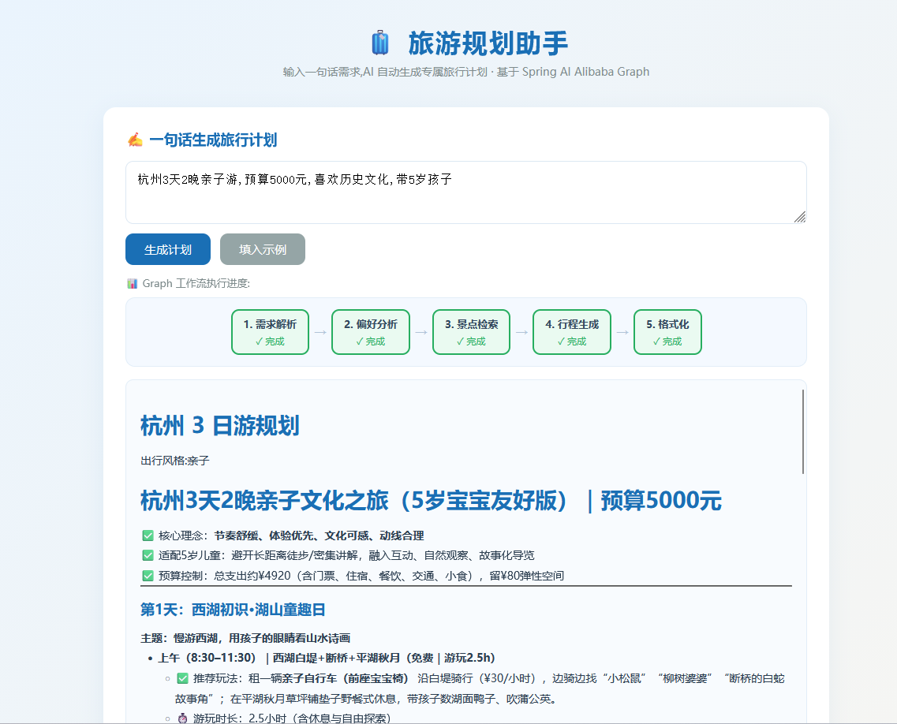
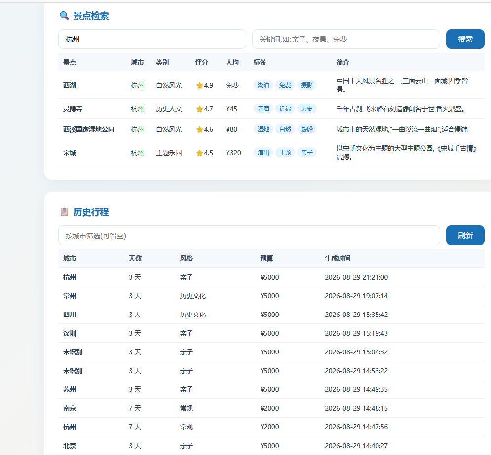

# Lion MCP Travel Planner 旅游规划助手

基于 **Spring Boot 3.5 + Spring AI Alibaba Graph 工作流引擎** 的旅游规划助手 **MCP Server**，
对外暴露 MCP 工具供其他工程（AI Agent / MCP Client）调用，同时提供 REST 接口与简单 HTML 前端页面。

## 功能特性

- **MCP Server（SSE）**：对外暴露 `searchAttractions` / `generateTravelPlan` / `listCities` 三个工具
- **Graph 工作流编排**：需求解析 → 偏好分析 → 景点检索 → 行程生成 → 格式化输出（spring-ai-alibaba-graph-core）
- **大模型驱动**：DashScope（通义千问）生成行程；无 API Key 时自动降级本地模板，保证可演示
- **数据持久化**：MyBatis-Plus + MySQL，景点/行程落库
- **缓存与分布式锁**：Redisson + Redis，相同参数行程秒级返回，防止并发重复调用大模型
- **REST 接口 + HTML 前端**：浏览器即可体验

## 界面预览

### 一句话生成旅行计划

输入需求后，Graph 工作流会逐步执行并展示进度，最终生成完整的 Markdown 行程。



### 景点检索与历史行程

支持按城市和关键词检索景点，并查看已生成的历史行程记录。



## 技术栈

| 分类 | 技术 | 版本 |
|---|---|---|
| 框架 | Spring Boot | 3.5.4 |
| JDK | Java | 21 |
| AI | Spring AI / DashScope(通义千问) | 1.1.2 / 1.1.2.0 |
| 工作流 | spring-ai-alibaba-graph-core | 1.1.2.0 |
| ORM | MyBatis-Plus | 3.5.12 |
| 数据库 | MySQL | 8.x |
| 缓存/锁 | Redisson(Redis) | 3.37.0 |
| 工具 | Hutool | 5.8.32 |

## 项目结构

```
lion-mcp-travel-planner
├── pom.xml
├── sql/schema.sql                     # 建库建表 + 种子数据
└── src/main
    ├── java/com/lion/travel
    │   ├── TravelPlannerApplication   # 启动类
    │   ├── common                     # 统一返回 Result / 全局异常处理
    │   ├── config                     # MyBatis-Plus 配置、字段自动填充
    │   ├── controller                 # REST 接口(前端页面调用)
    │   ├── entity                     # Attraction / Itinerary 实体
    │   ├── mapper                     # MyBatis-Plus Mapper
    │   ├── service                    # 景点检索 / 行程持久化 / AI 编排
    │   ├── graph                      # StateGraph 工作流(节点 + 图定义)
    │   └── mcp/TravelTools            # MCP 工具(@Tool 注解)
    └── resources
        ├── application.yml
        └── static/index.html          # HTML 前端页面
```

## Graph 工作流

```
START → 需求解析(requirement) → 偏好分析(analysis) → 景点检索(search)
      → 行程生成(plan) → 格式化输出(format) → END
```

- `requirement`：规则解析需求文本，提取 城市/天数/预算/风格（离线可用）
- `analysis`：规则未识别时调用大模型补全（失败静默降级）
- `search`：按城市查 MySQL 景点，组装文本
- `plan`：大模型生成 Markdown 行程；失败降级本地模板
- `format`：组装最终输出

## 快速开始

### 1. 环境准备

- JDK 21（IDEA: Settings → Build Tools → Maven → JDK for importer / Runner JRE 选 21）
- Maven 3.6+（联网下载依赖）
- MySQL 8.x、Redis 5+

### 2. 初始化数据库

```bash
mysql -uroot -p < sql/schema.sql
```

### 3. 配置环境变量（敏感信息不写入配置文件）

所有密钥/口令通过环境变量注入，`application.yml` 中不允许出现明文敏感信息。
参考模板见项目根目录 `.env.example`。

**必配变量（未设置时应用无法启动）：**

| 变量 | 说明 |
|---|---|
| `DASHSCOPE_API_KEY` | 通义千问 API Key |
| `MYSQL_USER` | 数据库用户名 |
| `MYSQL_PASSWORD` | 数据库密码 |
| `REDIS_PASSWORD` | Redis 密码（本地无密码可设为空） |

**可选变量（带默认值）：**

| 变量 | 默认值 |
|---|---|
| `SERVER_PORT` | 8083 |
| `MYSQL_HOST` / `MYSQL_PORT` / `MYSQL_DB` | localhost / 3306 / travel_planner |
| `REDIS_HOST` / `REDIS_PORT` | localhost / 6379 |
| `DASHSCOPE_MODEL` | qwen-plus |
| `TRAVEL_AI_ENABLED` | true（false 时走本地模板，无需 API Key 也能演示） |

设置方式（任选其一）：

- **IDEA**：Run/Debug Configurations → Environment variables 填入
  `DASHSCOPE_API_KEY=xxx;MYSQL_USER=xxkfz;MYSQL_PASSWORD=xxx;REDIS_PASSWORD=xxx`
- **PowerShell**（临时会话生效）：
  ```powershell
  $env:DASHSCOPE_API_KEY = "xxx"
  $env:MYSQL_USER = "xxkfz"
  $env:MYSQL_PASSWORD = "xxx"
  $env:REDIS_PASSWORD = "xxx"
  mvn spring-boot:run
  ```

### 4. 启动

```bash
mvn spring-boot:run
```

### 5. 访问

- 前端页面：<http://localhost:8083/>
- MCP Server SSE 端点：<http://localhost:8083/sse>
- 健康检查：<http://localhost:8083/api/health>

## REST 接口

| 方法 | 路径 | 说明 |
|---|---|---|
| GET | `/api/attractions?city=&keyword=` | 景点检索 |
| GET | `/api/cities` | 城市列表 |
| POST | `/api/itinerary/generate` | 生成行程 `{"requirements":"北京3天亲子游"}` |
| GET | `/api/itinerary/history?city=` | 历史行程 |
| GET | `/api/health` | 健康检查 |

## MCP 工具（供另一工程调用）

| 工具 | 说明 |
|---|---|
| `searchAttractions(city, keyword)` | 搜索景点 |
| `generateTravelPlan(requirements)` | 一句话生成旅行计划 |
| `listCities()` | 列出内置城市 |

### 对接 MCP Client（lion-agent）

配套的 AI Agent 工程 **[lion-agent](https://github.com/xxkfz-lioncode/lion-agent.git)**（MCP Client）通过 SSE 端点连接本 Server，即可在 Agent 对话中直接调用上述旅游规划工具。

```bash
git clone https://github.com/xxkfz-lioncode/lion-agent.git
```

MCP Client 通过 SSE 端点连接：

```bash
npx @modelcontextprotocol/inspector --transport http --url http://localhost:8083/sse
```

> 注意：本 Server 需先启动（`mvn spring-boot:run`），Client 侧配置的 MCP Server 地址为 `http://localhost:8083/sse`。

## 关键配置说明

```yaml
spring:
  ai:
    dashscope:
      api-key: ${DASHSCOPE_API_KEY}   # 通义千问 Key(环境变量注入,禁止写死)
    mcp:
      server:
        enabled: true
        sse-endpoint: /sse                # MCP SSE 端点
travel:
  ai-enabled: ${TRAVEL_AI_ENABLED:true}   # false 时全部走本地模板,无需 API Key
  cache-ttl-seconds: 3600                 # 行程缓存过期时间
```


