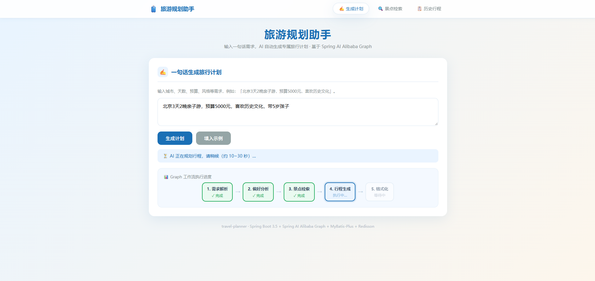
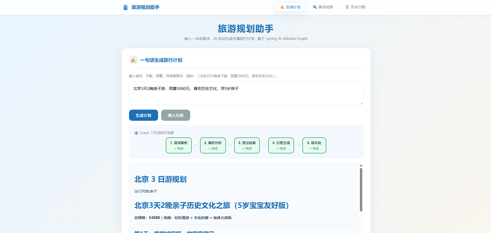
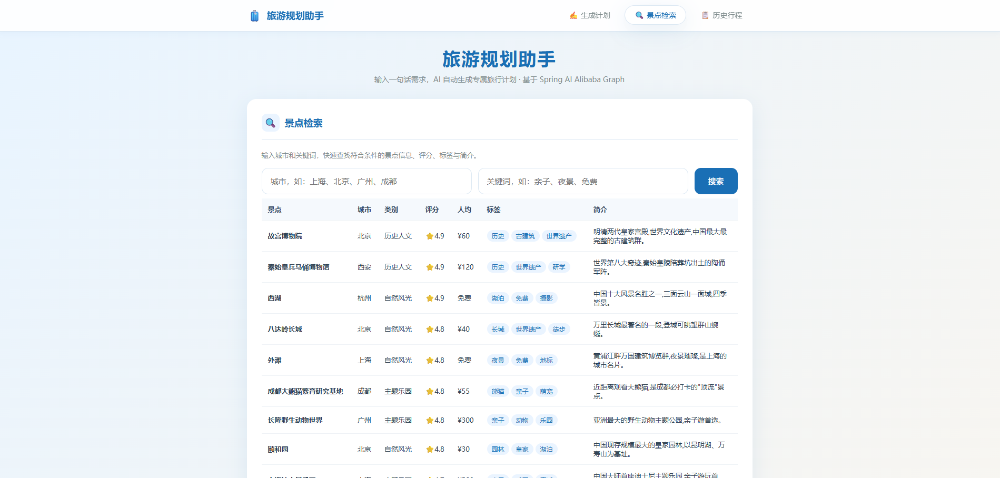
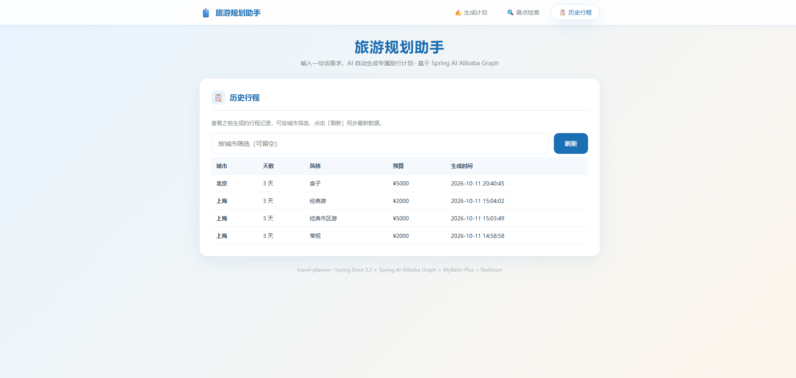
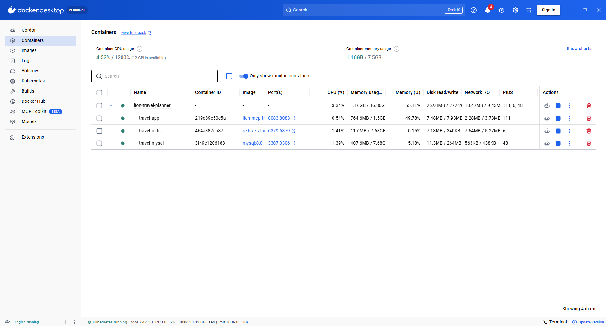

<div align="center">

<h1>🧭 Lion MCP Travel Planner</h1>

### 旅游规划助手 · MCP Server

一句话生成旅行行程，并以 MCP 工具形式供 AI Agent / MCP Client 直接调用

基于 `Spring Boot 3.5` + `Spring AI Alibaba Graph` + `DashScope(通义千问)` + `MyBatis-Plus` + `Redisson` 构建，
覆盖「需求解析 → 偏好分析 → 景点检索 → 行程生成 → 格式化输出」完整闭环。

<p>
  
  
  
  
  
  <br>
  
  
  
  
</p>

[项目简介](#功能特性) · [界面预览](#界面预览) · [技术栈](#技术栈) · [项目结构](#项目结构) · [Graph 工作流](#graph-工作流) · [Graph 知识点](#spring-ai-alibaba-graph-知识点) · [快速开始](#快速开始) · [REST 接口](#rest-接口) · [MCP 工具](#mcp-工具供另一工程调用) · [Docker 部署](#docker-部署)

</div>

---

## 功能特性

- **MCP Server（Streamable HTTP）**：对外暴露 `searchAttractions` / `generateTravelPlan` / `listCities` 三个工具
- **Graph 工作流编排**：需求解析 → 偏好分析 → 景点检索 → 行程生成 → 格式化输出（spring-ai-alibaba-graph-core）
- **大模型驱动**：DashScope（通义千问）生成行程；无 API Key 时自动降级本地模板，保证可演示
- **数据持久化**：MyBatis-Plus + MySQL，景点/行程落库
- **缓存与分布式锁**：Redisson + Redis，相同参数行程秒级返回，防止并发重复调用大模型
- **REST 接口 + HTML 前端**：浏览器即可体验

## 界面预览

### 首页 · 一句话生成旅行计划

输入自然语言需求（如「杭州3天2晚亲子游，预算5000元，喜欢历史文化」），
后台 Graph 工作流逐步执行，页面同步展示「需求解析 → 偏好分析 → 景点检索 → 行程生成 → 格式化」的实时进度。



### 行程生成结果

生成完成后展示完整的 Markdown 行程（按天组织，含上午/下午/晚上安排、餐饮与住宿建议、行程小贴士）。



### 景点检索

按城市、关键词检索景点，返回评分、人均消费、开放时间、标签等信息。



### 历史行程

查看已生成的行程记录，支持按城市筛选与查看 Markdown 原文。



## 技术栈

| 分类 | 技术 | 版本 |
|---|---|---|
| 框架 | Spring Boot | 3.5.4 |
| JDK | Java | 21 |
| AI | Spring AI / DashScope(通义千问) | 1.1.2 / 1.1.2.0 |
| 工作流 | spring-ai-alibaba-graph-core | 1.1.2.0 |
| ORM | MyBatis-Plus | 3.5.12 |
| 数据库 | MySQL | 8.x |
| 缓存/锁 | Redisson(Redis) | 3.37.0 |
| 工具 | Hutool | 5.8.32 |

## 项目结构

```
lion-mcp-travel-planner
├── pom.xml
├── sql/schema.sql                     # 建库建表 + 种子数据
└── src/main
    ├── java/com/lion/travel
    │   ├── TravelPlannerApplication   # 启动类
    │   ├── common                     # 统一返回 Result / 全局异常处理
    │   ├── config                     # MyBatis-Plus 配置、字段自动填充
    │   ├── controller                 # REST 接口(前端页面调用)
    │   ├── entity                     # Attraction / Itinerary 实体
    │   ├── mapper                     # MyBatis-Plus Mapper
    │   ├── service                    # 景点检索 / 行程持久化 / AI 编排
    │   ├── graph                      # StateGraph 工作流(节点 + 图定义)
    │   └── mcp/TravelTools            # MCP 工具(@Tool 注解)
    └── resources
        ├── application.yml
        └── static/index.html          # HTML 前端页面
```

## Graph 工作流

```
START → 需求解析(requirement) → 偏好分析(analysis) → 景点检索(search)
      → 行程生成(plan) → 格式化输出(format) → END
```

- `requirement`：规则解析需求文本，提取 城市/天数/预算/风格（离线可用）
- `analysis`：规则未识别时调用大模型补全（失败静默降级）
- `search`：按城市查 MySQL 景点，组装文本
- `plan`：大模型生成 Markdown 行程；失败降级本地模板
- `format`：组装最终输出

## Spring AI Alibaba Graph 知识点

> 本项目工作流引擎基于官方 `spring-ai-alibaba-graph-core`（参考 [Spring AI Alibaba Graph 文档](https://java2ai.com/docs/frameworks/graph-core/core/core-library/)）。
> 它将 LangGraph 的「图编排」思想移植到 Java：把一次 AI 任务拆成一个个**节点**，用**边**串联成一张**有向图**，
> 所有节点读写同一份**共享状态**，图编译后即可执行，适合「多步推理 / 调工具 / 失败回退」的 Agent 工作流。

### 核心概念速览

| 概念 | 说明 |
|---|---|
| `State` / `OverAllState` | 贯穿全图的共享状态容器，节点通过它读写数据 |
| `Node`（节点） | 一段业务逻辑（函数式接口），入参 `OverAllState`，返回要写入状态的 `Map` |
| `Edge`（边） | 决定下一步执行哪个节点的路由 |
| `StateGraph` | 图构建器：负责注册节点、连边 |
| `CompiledGraph` | `graph.compile()` 后得到的可执行图 |
| `START` / `END` | 图的入口与终止哨兵节点 |

### 开发范式：搭图三步

1. **写节点逻辑**：每个节点是一个方法，签名 `Map<String, Object> x(OverAllState state)`，
   从 state 读输入、处理后返回需要更新的字段（对应本项目的 `graph/TravelGraphNodes.java`，
   节点是 `@Component`，内部可直接注入 `ChatModel`、Service 等 Spring Bean）；
2. **搭图**：在 `StateGraph` 上用 `addNode(名称, node_async(方法引用))` 注册节点、
   `addEdge(START → … → END)` 串联流程（对应 `graph/TravelGraphConfig.java`）：

   ```java
   StateGraph graph = new StateGraph()
       .addNode("requirement", node_async(nodes::requirement))
       .addNode("plan", node_async(nodes::plan))
       .addEdge(START, "requirement")
       .addEdge("requirement", "plan")
       .addEdge("plan", END);
   ```

3. **编译执行**：`CompiledGraph compiled = graph.compile();` 之后即可执行：
   - `compiled.invoke(Map.of(...))` 同步执行，返回 `Optional<OverAllState>`（本项目 Spring MVC 同步模型用它）；
   - `compiled.stream(...)` 流式执行，逐个节点产出结果推给调用方。

### 状态是如何流转的

- 初始状态由调用方传入（本项目放入 `userInput`、`requestId` 两个 key）；
- 节点执行完返回 `Map`，引擎会将该 Map 中的 key **覆盖/合并**回总状态，未提及的 key 原样保留——
  因此节点只需返回自己关心的字段，无需携带完整状态；
- 若字段需要「追加」语义（如多轮对话消息列表），可用 `AppendStrategy` 等 `KeyStrategy`
  定制合并策略（本项目各字段互不依赖，使用默认覆盖即可）。

### 进阶能力（本项目暂未用到，值得了解）

| 能力 | 说明 | API |
|---|---|---|
| 条件分支 | 节点执行后按路由函数结果跳转不同后续节点 | `addConditionalEdges(node, edge_async(...), Map.of(路由结果→节点))` |
| 并行执行 | 一个节点连多条出边，下游节点并行执行 | 从同一节点 `addEdge` 到多个节点 |
| 流式输出 | 逐节点产出结果，边执行边推给调用方 | `graph.stream(input, config)` |
| Checkpointer | 内置检查点，支持断点续跑、人机协作、跨轮记忆 | `RunnableConfig.threadId(...)` |

### 本项目的工程化实践

- **节点与 Spring 融合**：节点类 `TravelGraphNodes` 是普通 `@Component`，构造注入 `ChatModel`（DashScope）与业务 Service，天然支持依赖注入与测试；
- **图注册为单例 Bean**：`TravelGraphConfig` 以 `@Bean` 暴露 `CompiledGraph`，业务层直接注入复用；
- **状态 key 集中管理**：字段名收敛在 `GraphStateKeys` 常量类并内置安全取值方法，杜绝魔法字符串；
- **可观测**：`requestId` 随状态贯穿全图，节点在 `finally` 中向 `GraphProgress` 打点，前端可实时看到「需求解析 → … → 格式化」的进度；
- **节点内兜底**：大模型调用包在 try-catch 中，失败自动降级本地模板/默认值，避免单点故障中断整条链路；
- **编排与副作用解耦**：图只负责编排与产出结果，Redis 缓存、分布式锁、MySQL 落库等副作用放在图外的 `AiTravelService`，保持节点逻辑纯粹。

## 快速开始

### 1. 环境准备

- JDK 21（IDEA: Settings → Build Tools → Maven → JDK for importer / Runner JRE 选 21）
- Maven 3.6+（联网下载依赖）
- MySQL 8.x、Redis 5+

### 2. 初始化数据库

```bash
mysql -uroot -p < sql/schema.sql
```

### 3. 配置环境变量（敏感信息不写入配置文件）

所有密钥/口令通过环境变量注入，`application.yml` 中不允许出现明文敏感信息。
参考模板见项目根目录 `.env.example`。

**必配变量（未设置时应用无法启动）：**

| 变量 | 说明 |
|---|---|
| `DASHSCOPE_API_KEY` | 通义千问 API Key |
| `MYSQL_USER` | 数据库用户名 |
| `MYSQL_PASSWORD` | 数据库密码 |
| `REDIS_PASSWORD` | Redis 密码（本地无密码可设为空） |

**可选变量（带默认值）：**

| 变量 | 默认值 |
|---|---|
| `SERVER_PORT` | 8083 |
| `MYSQL_HOST` / `MYSQL_PORT` / `MYSQL_DB` | localhost / 3306 / travel_planner |
| `REDIS_HOST` / `REDIS_PORT` | localhost / 6379 |
| `DASHSCOPE_MODEL` | qwen-plus |
| `TRAVEL_AI_ENABLED` | true（false 时走本地模板，无需 API Key 也能演示） |

**`.env` 文件（本地开发/部署推荐，已被 `.gitignore` 忽略，不会打进 jar）：**

| 场景 | 读取位置 |
|---|---|
| 打包运行 `java -jar app.jar` | **jar 同级目录**下的 `.env`（与在哪个目录执行命令无关） |
| jar 同级无 `.env` / 开发态（IDE、`mvn spring-boot:run`） | 回退读取**当前工作目录**（项目根目录）下的 `.env` |

> 注意：`.env` 不会被打包进 jar，部署时需拷贝到 jar 同级目录；
> 若 OS 已存在同名真实环境变量，则 `.env` 中的值不会覆盖它。

设置方式（任选其一）：

- **IDEA**：Run/Debug Configurations → Environment variables 填入
  `DASHSCOPE_API_KEY=xxx;MYSQL_USER=xxkfz;MYSQL_PASSWORD=xxx;REDIS_PASSWORD=xxx`
- **PowerShell**（临时会话生效）：
  ```powershell
  $env:DASHSCOPE_API_KEY = "xxx"
  $env:MYSQL_USER = "xxkfz"
  $env:MYSQL_PASSWORD = "xxx"
  $env:REDIS_PASSWORD = "xxx"
  mvn spring-boot:run
  ```

### 4. 启动

```bash
mvn spring-boot:run
```

### 5. 访问

- 前端页面：<http://localhost:8083/>
- 在线接口文档（Swagger UI）：<http://localhost:8083/swagger-ui.html>
- MCP Server 端点（Streamable HTTP）：<http://localhost:8083/mcp>
- 健康检查：<http://localhost:8083/api/health>

## REST 接口

| 方法 | 路径 | 说明 |
|---|---|---|
| GET | `/api/attractions?city=&keyword=` | 景点检索 |
| GET | `/api/cities` | 城市列表 |
| POST | `/api/itinerary/generate` | 生成行程 `{"requirements":"北京3天亲子游"}` |
| GET | `/api/itinerary/history?city=` | 历史行程 |
| GET | `/api/health` | 健康检查 |

## MCP 工具（供另一工程调用）

| 工具 | 说明 |
|---|---|
| `searchAttractions(city, keyword)` | 搜索景点 |
| `generateTravelPlan(requirements)` | 一句话生成旅行计划 |
| `listCities()` | 列出内置城市 |

### 对接 MCP Client（lion-agent）

配套的 AI Agent 工程 **[lion-agent](https://github.com/xxkfz-lioncode/lion-agent.git)**（MCP Client）通过 **Streamable HTTP** 端点连接本 Server，即可在 Agent 对话中直接调用上述旅游规划工具。

```bash
git clone https://github.com/xxkfz-lioncode/lion-agent.git
```

MCP Client 通过 Streamable HTTP 端点连接：

```bash
npx @modelcontextprotocol/inspector --transport http --url http://localhost:8083/mcp
```

> 注意：本 Server 需先启动（`mvn spring-boot:run`），Client 侧配置的 MCP Server 地址为 `http://localhost:8083/mcp`。
> 若在 `spring.ai.mcp.client.streamable-http.connections.<name>.url` 中配置，URL 同样指向 `http://localhost:8083/mcp`。

## Docker 部署

一条命令拉起 **应用 + MySQL + Redis**，无需本地安装 JDK / MySQL / Redis。

### 1. 准备环境变量

Docker Compose 会自动读取项目根目录的 `.env`（已被 `.gitignore` 忽略）：

```bash
cp .env.example .env   # Windows: copy .env.example .env
```

至少填写这些（`:?` 强校验，缺失会直接报错而不是静默启动失败）：

| 变量 | 说明 |
|---|---|
| `DASHSCOPE_API_KEY` | 通义千问 Key；无 Key 想演示可填 `none` 并把 `TRAVEL_AI_ENABLED=false` |
| `MYSQL_ROOT_PASSWORD` | MySQL root 密码（容器初始化用） |
| `MYSQL_USER` / `MYSQL_PASSWORD` | 应用使用的账号（Compose 会自动创建并授权） |
| `REDIS_PASSWORD` | Redis 密码，**不能为空**（否则应用侧空密码连不上） |

### 2. 打包（Dockerfile 不负责编译，必须先出 jar）

```bash
mvn clean package -DskipTests   # Windows 也可双击执行 bin\package-backend.bat
```

产物：`target/lion-mcp-travel-planner-1.0.0.jar`。改了 jar 名时用 `docker build --build-arg JAR_FILE=xxx.jar` 覆盖。

### 3. 启动

```bash
docker compose up -d --build    # 镜像构建秒级完成（只拷贝 jar）
docker compose logs -f app      # 看到 "启动成功" 即就绪
```

首次启动时 `sql/schema.sql` 会被挂载到 MySQL 的 `/docker-entrypoint-initdb.d/`，自动建库建表并导入种子景点数据。
> 该脚本**仅在数据卷为空时**执行一次；换数据后需 `docker compose down -v` 才会重新初始化。

### 4. 访问

| 服务 | 地址 |
|---|---|
| 前端页面 | <http://localhost:8083/> |
| Swagger UI | <http://localhost:8083/swagger-ui.html> |
| MCP 端点 | <http://localhost:8083/mcp> |
| 健康检查 | <http://localhost:8083/api/health> |
| MySQL | `localhost:3307`（`MYSQL_EXPOSE_PORT` 可改） |
| Redis | `localhost:6379`（`REDIS_EXPOSE_PORT` 可改） |

### 5. 容器运行状态

`app` / `mysql` / `redis` 三个容器均在运行且健康：



### 6. 常用命令

```bash
docker compose ps                  # 查看状态（app 需在 mysql/redis healthy 后才启动）
docker compose restart app         # 重启应用
docker compose down                # 停止并删除容器，数据卷保留
docker compose down -v             # 连数据一起清理
docker compose build --no-cache app  # 强制重新构建镜像
```

### 实现要点

- **单阶段构建**：镜像不负责编译，直接 `COPY target/<jar>` 到 `eclipse-temurin:21-jre-jammy`，构建秒级完成；jar 名可用 `--build-arg JAR_FILE=xxx.jar` 覆盖（需与 `pom.xml` 的 artifactId/version 一致）。
- **构建前置**：`docker compose up -d --build` 前必须先出 jar —— `mvn clean package -DskipTests`（Windows 可用 `bin\package-backend.bat`），否则 COPY 会报 `target/xxx.jar: no such file`。
- **上下文裁剪**：`.dockerignore` 只排除 `target/classes`、`*.jar.original` 等中间产物，**保留 `target/*.jar`**。
- **非 root 运行**：容器以 `appuser`（uid 10001）启动，`/app` 归属该用户。
- **健康探针**：内置 `HEALTHCHECK` 调用 `/api/health`；`app` 通过 `depends_on: condition: service_healthy` 等 MySQL / Redis 真正就绪后才启动，避免启动期连库失败。
- **配置注入**：密钥只经环境变量传入，镜像内不含敏感信息；也可把 `.env` 挂载到 `/app/.env`（`EnvFileLoader` 会读 jar 同级目录），真实环境变量优先级更高。
- **时区/字符集**：容器统一 `Asia/Shanghai` + `C.UTF-8`，MySQL 使用 `utf8mb4`，与 `serverTimezone=Asia/Shanghai` 对齐。

## 关键配置说明

```yaml
spring:
  ai:
    dashscope:
      api-key: ${DASHSCOPE_API_KEY}   # 通义千问 Key(环境变量注入,禁止写死)
    mcp:
      server:
        enabled: true
        protocol: STREAMABLE             # Streamable HTTP 协议(主流客户端默认)
        streamable-http:
          mcp-endpoint: /mcp             # MCP 端点,客户端按 http://host:8083/mcp 连接
travel:
  ai-enabled: ${TRAVEL_AI_ENABLED:true}   # false 时全部走本地模板,无需 API Key
  cache-ttl-seconds: 3600                 # 行程缓存过期时间
```
